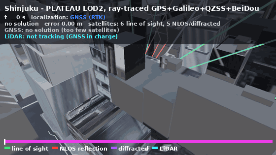
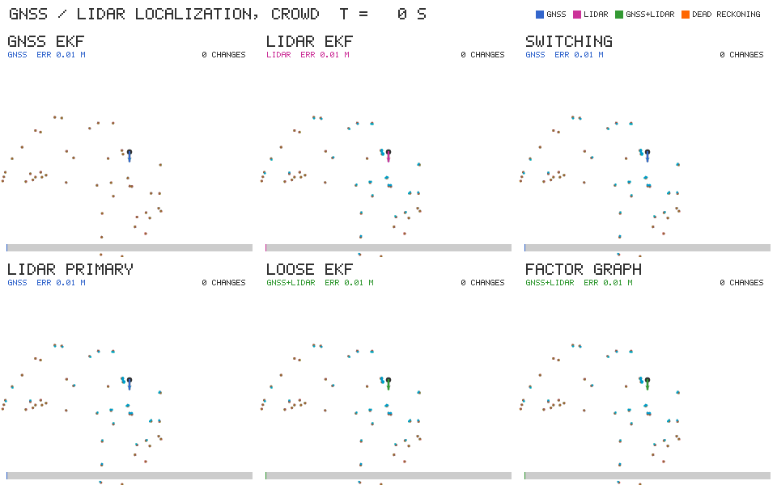
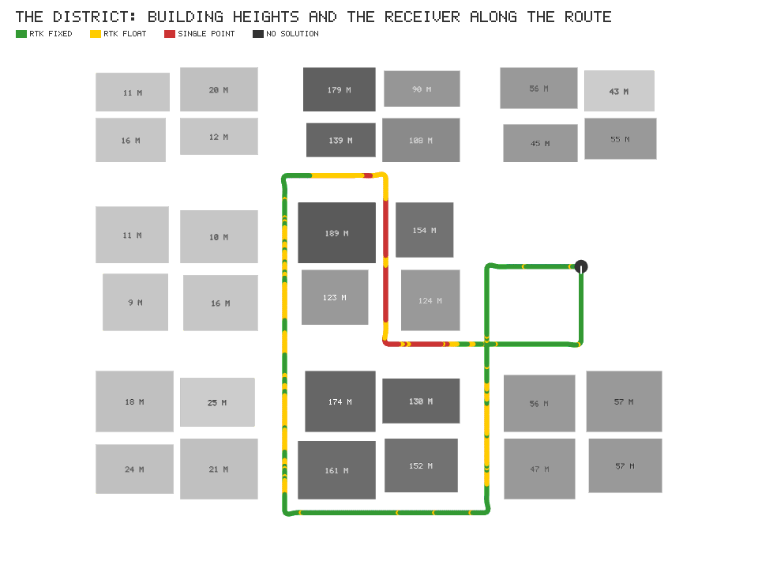
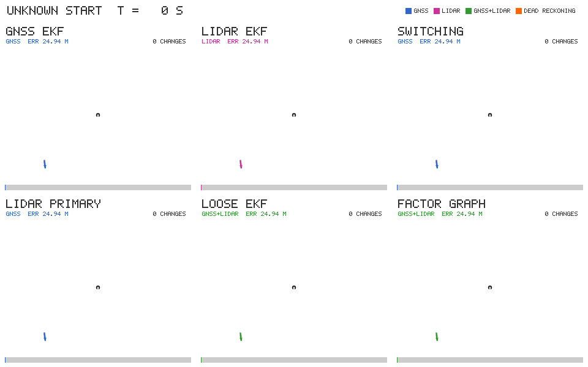
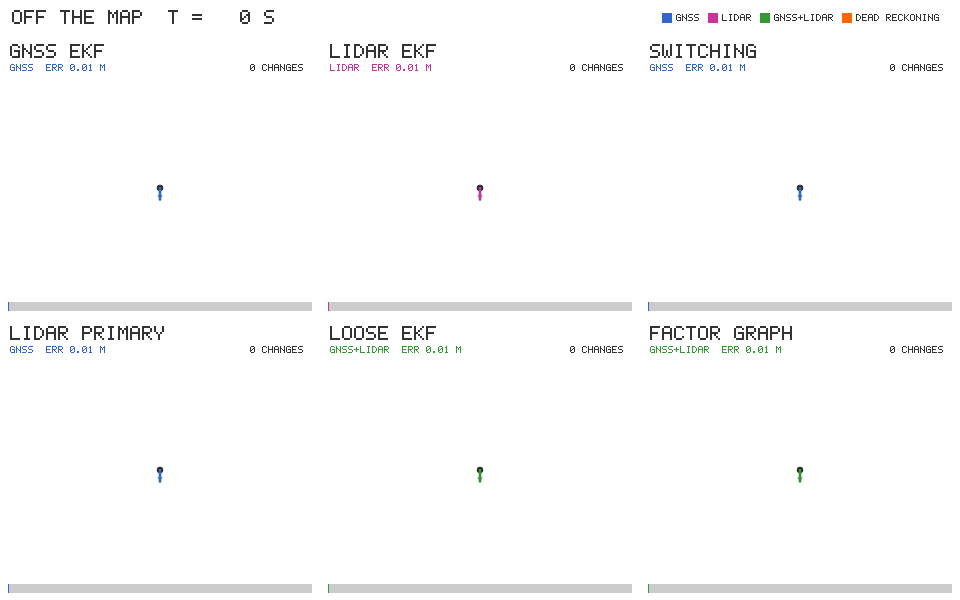
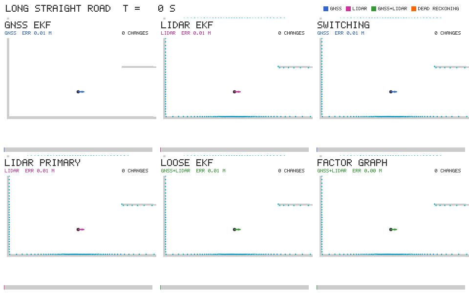
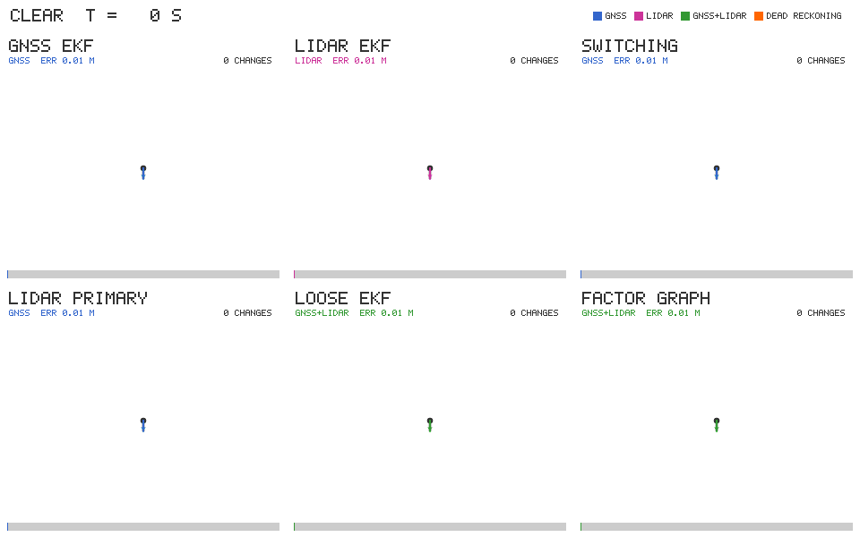
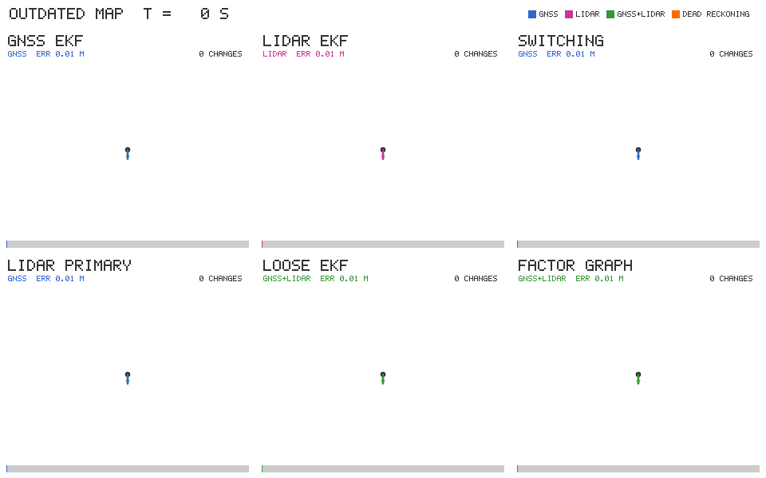

# robo-localization

GNSS / LiDAR / odometry localization methods, compared in a simulated street
canyon, in deterministic Rust with no required dependencies. Companion of
[robo-planning](https://github.com/rsasaki0109/robot-planning) and
[robo-control](https://github.com/rsasaki0109/robot-control); the GNSS, LiDAR
SLAM, LiDAR localization and visual localization stacks this builds on are
included as submodules ([below](#components-submodules)).

GNSS と LiDAR 地図照合をどう組み合わせるか（排他的に切り替える・LiDAR を主に
RTK で補正する・EKF でまとめて融合する・ファクターグラフで重み付けする）を、
同じビル街・同じセンサノイズで比べるリポジトリです。LiDAR 地図が得意な場面
（正確な地図・既知の初期位置）だけでなく、初期位置が分からない・地図の外・
長い一本道・工事で地図と街が食い違う、という GNSS が要る場面も比べています。GNSS（libgnss++）、
LiDAR SLAM、LiDAR 地図照合、Visual localization の各スタックはサブモジュールで
入っています。


*The methods at full scale in
[RobotNativeEngine](https://github.com/rsasaki0109/RobotNativeEngine)
(example 152): a robot crosses Shibuya's scramble crossing and walks up
Koen-dori at rush hour in the rain, among PLATEAU's photo-textured LOD2
buildings, with crowds, traffic and a 3D LiDAR. Every GNSS signal is ray
traced through the city: green rays reach the antenna in line of sight, red
ones only by reflection off a facade (drawn through their reflection
points), purple ones by diffraction over a roof edge. Cyan points are the
LiDAR's returns. The trail is blue while GNSS (GPS, Galileo, QZSS and BeiDou
with RTK) localizes the robot and magenta while the LiDAR map does: the
LiDAR-primary arbiter below takes LiDAR once and keeps it, with RTK fixes as
corrections.*



*The same in Nishi-Shinjuku, among the skyscrapers west of the station, on
a clear day. Data: 3D City Model (Tokyo 23 wards) 2020, Project PLATEAU /
MLIT, used under the PLATEAU site policy (compatible with CC BY 4.0); these
renders are derived from it.*

## The comparison

The rest of this repository compares the ways of combining GNSS and a LiDAR
map in a small simulated district where every method sees the same drive
and the same noise:



*Six localizers on the same drive through a crowded district (600 people).
Each panel follows the robot: buildings shaded by height, people (brown), the
LiDAR scan (cyan), the latest GNSS fix (green RTK fixed, yellow float, red
single), the true track (black) and the estimate's, coloured by what it rests
on. The strip under each panel is the run's source timeline: every colour
change is a change of source. The switching arbiter trades GNSS and LiDAR back
and forth; the LiDAR-primary arbiter takes LiDAR once and keeps it.*

### The district



A 400 m x 300 m business district in miniature (`city`): low-rise blocks in
the west, 90–220 m towers in the middle with a 12 m alley between them,
mid-rise blocks in the east and an open park. The 844 m route starts in the
park, runs down the tower canyon, up the alley, along the low-rise street and
back. Every satellite of a 31-satellite sky (GPS, Galileo, BeiDou and a QZSS
near the zenith) is traced against the buildings each epoch (`gnss`):

* **line of sight**, or **reflected** off a facade behind the antenna (the
  extra path, 2 r cos(el), is a pseudorange bias; only reflections from
  facades within 50 m and above the receiver's C/N0 mask are tracked), or
  **blocked**;
* the single-point error is the weighted least-squares solution's response to
  the biases and the code noise, after the receiver's fault exclusion (the
  worst normalized residual dropped while above 4, up to four times);
* **RTK fixed** with seven or more line-of-sight satellites and at most two
  reflected ones in the solution — and then, with reflected satellites,
  sometimes **wrong**: 0.4–2.5 m off for 3–14 epochs while still reporting
  2 cm; **float** with five or more line-of-sight satellites (decimetres to
  metres); **single** otherwise.

The open park and the south street fix; the tower canyon and the alley give
single-point solutions 15–30 m off. The LiDAR (`lidar`, 180 beams, 40 m) is
ray traced against the footprints and the people, and matched to the map's
facade segments by Huber-weighted point-to-line Gauss–Newton whose search
narrows from 1.5 m to 0.3 m as it converges (so people a metre from a wall
stop pulling it), with the covariance from the inverse information: in a
street between two straight walls it is loose along the street and tight
across it. Wheel odometry has about 1 % scale error and a calibrated MEMS
gyro's bias (about 100 deg/h); the EKFs model the scale error as 25 %
speed noise, enough to cover a systematic 1 % over a minute. The robot drives the route by pure pursuit at
1.2 m/s; every method sees the same drive and the same noise.

### The methods

| Method | GNSS | LiDAR map | How they combine (`methods`) |
|---|:---:|:---:|---|
| GNSS EKF | ✓ | | EKF on odometry; fixes gated at 99 %; after 20 rejected RTK fixed fixes that agree with each other relative to the odometry, the estimate moves onto them |
| LiDAR EKF | | ✓ | EKF on odometry; matches gated against their covariance; a wider gate after 2 s without one; starts or relocalizes only from an estimate within 2 m (sigma) |
| switching | ✓ | ✓ | one source in charge: GNSS hands over after 3 unusable epochs, LiDAR takes over when a scan matches, GNSS takes back over after 5 good RTK fixed fixes in a row |
| LiDAR primary | ✓ | ✓ | LiDAR takes charge wherever a scan matches and keeps it; RTK fixed fixes that pass the gate are fused as corrections; GNSS is in charge only where the map cannot place the robot |
| loose EKF | ✓ | ✓ | every gated fix and match into one EKF, nothing switched |
| factor graph | ✓ | ✓ | 8 s sliding window, a node per scan: odometry between nodes, Huber-weighted LiDAR matches with their covariance, Cauchy-weighted GNSS fixes; float and single fixes join only within 3 sigma; for 3 s after an RTK fixed fix carried weight, a match more than 0.3 m from the graph is left out; from an unknown start, GNSS alone (plain least squares) until an RTK fixed fix anchors the graph |

### Results (`cargo run --release --example compare -- 5`)

RMSE, median over 5 seeds (the worst seed's in brackets):

| Method | clear | crowd | outdated map | unknown start | off the map | long straight road | construction |
|---|---|---|---|---|---|---|---|
| GNSS EKF | 1.59 m (19.3 m) | 1.59 m (19.3 m) | 1.59 m (19.3 m) | 1.84 m (19.4 m) | 1.59 m (19.3 m) | 0.02 m (0.03 m) | 1.59 m (19.3 m) |
| LiDAR EKF | 0.08 m (0.16 m) | 0.12 m (0.22 m) | 0.17 m (0.23 m) | **35.0 m** (41.3 m) | **7.14 m** (10.6 m) | **3.22 m** (7.13 m) | **1.20 m** (2.14 m) |
| switching | 0.02 m (0.03 m) | 0.02 m (0.09 m) | 0.07 m (0.10 m) | 0.92 m (0.92 m) | 0.14 m (0.27 m) | 0.02 m (0.03 m) | 0.04 m (0.09 m) |
| LiDAR primary | 0.01 m (0.02 m) | 0.02 m (0.03 m) | 0.09 m (0.09 m) | 0.92 m (0.92 m) | 0.15 m (0.33 m) | 0.02 m (0.03 m) | 0.02 m (0.09 m) |
| loose EKF | 0.01 m (0.02 m) | 0.02 m (0.03 m) | 0.09 m (0.10 m) | 0.92 m (0.92 m) | 0.04 m (0.06 m) | 0.02 m (0.03 m) | 0.02 m (0.08 m) |
| factor graph | 0.02 m (0.03 m) | 0.02 m (0.04 m) | 0.08 m (0.08 m) | 0.92 m (0.92 m) | 0.11 m (0.24 m) | 0.02 m (0.03 m) | 0.02 m (0.04 m) |

**Conditions** (`sim::Condition`):

* *clear* — an empty street and an exact map.
* *crowd* — 600 people on the sidewalks, a quarter of them walking within
  2.5 m of the route.
* *outdated map* — a map surveyed a year ago: every footprint off by about
  12 cm, two buildings built since missing from it, a kiosk and a fence
  removed since still in it.
* *unknown start* — switched on somewhere: every method starts 25 m from the
  truth (sigma 30 m), with the heading from a magnetometer within about 10°.
* *off the map* — the south-west quarter of the district (the south half of
  the low-rise street and the whole south street) is not in the LiDAR map
  yet.
* *long straight road* — a different place: two 600 m lanes either side of a
  median barrier, between straight noise barriers, open sky above.
* *construction* — the south tower block was rebuilt after the survey: its
  buildings stand 2.5 m from where the map has them.

The first three conditions are where a LiDAR map is at home, and there it
carries the combined methods: GNSS alone dead reckons through half of the
drive (canyons whose fixes are 15–30 m off) and the LiDAR map alone holds the
robot to decimetres. The last four are where it is not, and there **GNSS is
what keeps the robot localized**:

* **Unknown start.** A scan matcher converges only from near the answer: the
  LiDAR filter never finds itself (35 m RMSE, the whole run dead reckoned).
  Every method with GNSS takes the first RTK fixed fix in the park, is within
  1 m after 1 s and stays there (the 0.92 m RMSE is that first second's
  25 m). GNSS gives the global position; LiDAR then holds it.
* **Off the map.** Where the map has nothing, the LiDAR filter dead reckons
  half the drive and ends up to 24 m off (7.1 m RMSE). With GNSS the
  combined methods carry on at 0.04–0.15 m: the south street fixes, and the
  map takes over again where it starts.
* **Long straight road.** Two straight walls pin the robot across the road
  but not along it; the LiDAR filter slides with the wheels' 1 % scale error,
  up to 5.8 m by the far end (3.2 m RMSE). Open sky: every method with RTK
  stays at 2 cm.
* **Construction.** The scans fit the rebuilt block's walls where the map
  does not have them, and the LiDAR filter follows them 1–2.7 m off. RTK
  fixes on the south street pull every combined method back (0.02–0.04 m RMSE,
  0.13–0.39 m at worst).

Neither sensor is enough alone; the question is how to combine them:

* **Switching** is accurate, but hands over 15 times a lap: every canyon exit
  sends it back to GNSS, every canyon entry to LiDAR, and each hand-over
  moves the estimate onto the other source's frame — which is what looks
  unsettling in a replay.
* **LiDAR primary** is as accurate with 3 hand-overs a lap (GNSS → LiDAR at
  the park's edge, and back in the park), and RTK fixed fixes correct it
  wherever they arrive.
* **Fusing** (loose EKF, factor graph) does not hand over at all and is the
  most accurate, or within 2 cm of it, in every condition.

<details>
<summary>Details: 95 % error, maximum, when the error was last over 1 m, hand-overs and what the estimate rested on (medians over 5 seeds)</summary>

| Method | Condition | RMSE | 95 % | Max | Last over 1 m | Hand-overs | GNSS / LiDAR / both / dead reckoning |
|---|---|---|---|---|---|---|---|
| GNSS EKF | 1.59 m (19.3 m) | 1.59 m (19.3 m) | 1.59 m (19.3 m) | 1.84 m (19.4 m) | 1.59 m (19.3 m) | 0.02 m (0.03 m) | 1.59 m (19.3 m) |
| LiDAR EKF | 0.08 m (0.16 m) | 0.12 m (0.22 m) | 0.17 m (0.23 m) | 35.0 m (41.3 m) | 7.14 m (10.6 m) | 3.22 m (7.13 m) | 1.20 m (2.14 m) |
| switching | 0.02 m (0.03 m) | 0.02 m (0.09 m) | 0.07 m (0.10 m) | 0.92 m (0.92 m) | 0.14 m (0.27 m) | 0.02 m (0.03 m) | 0.04 m (0.09 m) |
| LiDAR primary | 0.01 m (0.02 m) | 0.02 m (0.03 m) | 0.09 m (0.09 m) | 0.92 m (0.92 m) | 0.15 m (0.33 m) | 0.02 m (0.03 m) | 0.02 m (0.09 m) |
| loose EKF | 0.01 m (0.02 m) | 0.02 m (0.03 m) | 0.09 m (0.10 m) | 0.92 m (0.92 m) | 0.04 m (0.06 m) | 0.02 m (0.03 m) | 0.02 m (0.08 m) |
| factor graph | 0.02 m (0.03 m) | 0.02 m (0.04 m) | 0.08 m (0.08 m) | 0.92 m (0.92 m) | 0.11 m (0.24 m) | 0.02 m (0.03 m) | 0.02 m (0.04 m) |
| GNSS EKF | clear | 1.59 m | 5.08 m | 6.09 m | 603 s | – | 49 % / 0 % / 0 % / 51 % |
| GNSS EKF | crowd | 1.59 m | 5.08 m | 6.09 m | 603 s | – | 49 % / 0 % / 0 % / 51 % |
| GNSS EKF | outdated map | 1.59 m | 5.08 m | 6.09 m | 603 s | – | 49 % / 0 % / 0 % / 51 % |
| GNSS EKF | unknown start | 1.84 m | 5.10 m | 25.1 m | 603 s | – | 49 % / 0 % / 0 % / 51 % |
| GNSS EKF | off the map | 1.59 m | 5.08 m | 6.09 m | 603 s | – | 49 % / 0 % / 0 % / 51 % |
| GNSS EKF | long straight road | 0.02 m | 0.04 m | 0.06 m | never | – | 100 % / 0 % / 0 % / 0 % |
| GNSS EKF | construction | 1.59 m | 5.08 m | 6.09 m | 603 s | – | 49 % / 0 % / 0 % / 51 % |
| LiDAR EKF | clear | 0.08 m | 0.18 m | 0.52 m | never | – | 0 % / 92 % / 0 % / 8 % |
| LiDAR EKF | crowd | 0.12 m | 0.25 m | 1.00 m | 476 s | – | 0 % / 90 % / 0 % / 10 % |
| LiDAR EKF | outdated map | 0.17 m | 0.32 m | 0.91 m | never | – | 0 % / 92 % / 0 % / 8 % |
| LiDAR EKF | unknown start | 35.0 m | 53.0 m | 56.4 m | 703 s | – | 0 % / 0 % / 0 % / 100 % |
| LiDAR EKF | off the map | 7.14 m | 19.0 m | 24.0 m | 703 s | – | 0 % / 49 % / 0 % / 51 % |
| LiDAR EKF | long straight road | 3.22 m | 5.60 m | 5.80 m | 980 s | – | 0 % / 99 % / 0 % / 1 % |
| LiDAR EKF | construction | 1.20 m | 2.51 m | 2.68 m | 618 s | – | 0 % / 87 % / 0 % / 13 % |
| switching | clear | 0.02 m | 0.04 m | 0.09 m | never | 15 | 49 % / 50 % / 0 % / 0 % |
| switching | crowd | 0.02 m | 0.04 m | 0.27 m | never | 15 | 49 % / 51 % / 0 % / 0 % |
| switching | outdated map | 0.07 m | 0.18 m | 0.29 m | never | 15 | 46 % / 54 % / 0 % / 0 % |
| switching | unknown start | 0.92 m | 0.04 m | 25.0 m | 1 s | 15 | 49 % / 50 % / 0 % / 0 % |
| switching | off the map | 0.14 m | 0.35 m | 0.85 m | never | 16 | 49 % / 43 % / 0 % / 7 % |
| switching | long straight road | 0.02 m | 0.04 m | 0.06 m | never | 0 | 100 % / 0 % / 0 % / 0 % |
| switching | construction | 0.04 m | 0.04 m | 0.39 m | never | 15 | 49 % / 51 % / 0 % / 0 % |
| LiDAR primary | clear | 0.01 m | 0.03 m | 0.09 m | never | 3 | 7 % / 92 % / 0 % / 1 % |
| LiDAR primary | crowd | 0.02 m | 0.03 m | 0.10 m | never | 3 | 9 % / 91 % / 0 % / 1 % |
| LiDAR primary | outdated map | 0.09 m | 0.22 m | 0.42 m | never | 3 | 7 % / 92 % / 0 % / 1 % |
| LiDAR primary | unknown start | 0.92 m | 0.03 m | 25.0 m | 1 s | 3 | 7 % / 92 % / 0 % / 1 % |
| LiDAR primary | off the map | 0.15 m | 0.36 m | 0.90 m | never | 6 | 22 % / 69 % / 0 % / 9 % |
| LiDAR primary | long straight road | 0.02 m | 0.03 m | 0.06 m | never | 1 | 0 % / 100 % / 0 % / 0 % |
| LiDAR primary | construction | 0.02 m | 0.03 m | 0.32 m | never | 6 | 20 % / 79 % / 0 % / 2 % |
| loose EKF | clear | 0.01 m | 0.02 m | 0.05 m | never | – | 8 % / 37 % / 55 % / 0 % |
| loose EKF | crowd | 0.02 m | 0.03 m | 0.10 m | never | – | 10 % / 37 % / 54 % / 0 % |
| loose EKF | outdated map | 0.09 m | 0.21 m | 0.39 m | never | – | 7 % / 41 % / 51 % / 1 % |
| loose EKF | unknown start | 0.92 m | 0.02 m | 25.0 m | 1 s | – | 8 % / 37 % / 55 % / 0 % |
| loose EKF | off the map | 0.04 m | 0.05 m | 0.29 m | never | – | 27 % / 32 % / 36 % / 5 % |
| loose EKF | long straight road | 0.02 m | 0.03 m | 0.06 m | never | – | 0 % / 0 % / 100 % / 0 % |
| loose EKF | construction | 0.02 m | 0.03 m | 0.32 m | never | – | 22 % / 37 % / 42 % / 0 % |
| factor graph | clear | 0.02 m | 0.03 m | 0.07 m | never | – | 8 % / 37 % / 55 % / 0 % |
| factor graph | crowd | 0.02 m | 0.03 m | 0.22 m | never | – | 10 % / 37 % / 53 % / 0 % |
| factor graph | outdated map | 0.08 m | 0.18 m | 0.29 m | never | – | 8 % / 44 % / 48 % / 0 % |
| factor graph | unknown start | 0.92 m | 0.03 m | 25.0 m | 1 s | – | 8 % / 37 % / 55 % / 0 % |
| factor graph | off the map | 0.11 m | 0.06 m | 1.69 m | 417 s | – | 27 % / 32 % / 36 % / 5 % |
| factor graph | long straight road | 0.02 m | 0.03 m | 0.05 m | never | – | 0 % / 0 % / 100 % / 0 % |
| factor graph | construction | 0.02 m | 0.03 m | 0.13 m | never | – | 22 % / 37 % / 41 % / 0 % |

*Hand-overs* counts changes of the source in charge, for the two arbiters;
the fusing methods do not hand over (their source split only says which
measurements carried weight). GNSS EKF is the same in every condition of the
district: people and maps do not affect it.

</details>

Along the way the simulation found failures that the methods now guard
against:

* the factor graph's float fixes in a canyon (biased the same way for many
  epochs) dragged its window 14 m, until float and single fixes joined only
  within 3 sigma;
* scan matches sliding along a crowded street pushed the graph 2–3 m away
  from correct RTK fixes, which the Cauchy kernel then discounted, until an
  RTK fix that carried weight held matches that disagree out for 3 s;
* the EKFs modelled the wheels' scale error as white noise and grew so sure
  of themselves on the long road that they gated out correct RTK fixes and
  slid 12 m, until the odometry noise covered a systematic 1 %;
* with an unknown start, a scan matched from a wrong estimate fits the wrong
  street, so LiDAR starts or relocalizes only from an estimate within 2 m
  (sigma), and the factor graph matches no scans until an RTK fixed fix has
  anchored it.

These numbers are from a simulation in which the LiDAR's map is the world
itself (or a known distortion of it); a real map adds its survey error, and
real reflections, multipath and RTK failures are richer than this model.
The arbiters and the factor graph have full-size counterparts in
[RobotNativeEngine](https://github.com/rsasaki0109/RobotNativeEngine), run
against PLATEAU's 3D city models of Shibuya and Nishi-Shinjuku with
ray-traced GNSS and a 3D LiDAR (example 152): `rne_slam::HybridLocalizer`
switches, with `HybridLocalizerConfig::lidar_keeps_charge` it is LiDAR
primary, and `FactorGraphLocalizer` is the factor graph.

| | |
|:---:|:---:|
|  |  |
| unknown start: everything with GNSS finds itself at the first RTK fix; the LiDAR filter never does | off the map (purple: the map's footprints; the south-west blocks have none) |
|  |  |
| long straight road: the LiDAR filter slides along the road with the wheels | construction: the rebuilt block stands 2.5 m from its outline in the map |
|  |  |
| clear | outdated map |

## Components (submodules)

The methods here take position fixes and scan matches; producing them on a
real robot is the job of these stacks, included under `third_party/`:

| Submodule | What it is | Its role here |
|---|---|---|
| [`gnssplusplus-library`](https://github.com/rsasaki0109/gnssplusplus-library) (libgnss++) | C++20 GNSS toolkit: SPP, RTK, PPP, CLAS/MADOCA, RTCM/UBX, QZSS L6 | the receiver: RTK fixed / float / single solutions (`gnss::Fix`) |
| [`lidar_slam`](https://github.com/rsasaki0109/lidar_slam) | ROS 2 LiDAR SLAM writing Autoware-compatible maps | builds the LiDAR map |
| [`lidar_localization_ros2`](https://github.com/rsasaki0109/lidar_localization_ros2) | map-based 3D LiDAR localization for ROS 2 and Nav2 (NDT, global localization) | the scan-to-map match (`lidar::ScanMatch`) |
| [`visloc-rs`](https://github.com/rsasaki0109/visloc-rs) | SfM, visual-inertial SLAM, 3D Gaussian Splatting and map-based localization in Rust | the camera's answer where LiDAR is not available |

```bash
git clone --recurse-submodules --shallow-submodules https://github.com/rsasaki0109/robot-localization
# or, in an existing clone:
git submodule update --init --depth 1
```

The crate does not build or link them: they are large stacks with their own
build systems (CMake, colcon, Cargo workspaces). Clone without
`--recurse-submodules` to get the methods alone.

## Usage

```bash
cargo run --release --example compare                     # the table, 3 seeds
cargo run --release --example compare -- 10               # 10 seeds
cargo run --release --features render --example gallery   # GIFs -> out/
```

```rust
use robo_localization::{city::City, methods::{Arbiter, Policy}, sim};

let city = City::district(1);
let mut localizer = Arbiter::new(sim::start_pose(&city), Policy::LidarPrimary);
let report = sim::run(&mut localizer, &city, sim::Condition::CROWD, 0, false);
println!("RMSE {:.2} m, {} hand-overs", report.rmse(), report.switches);
```

A new method implements `methods::Localizer` (`predict`, `gnss`, `lidar`,
`pose`, `source`) and joins `sim::all_methods`.

## Features

- default: the methods and the simulation, no dependencies.
- `render`: GIF output through robo-planning's renderer (`tiny-skia`, `gif`).

## Development

```bash
cargo fmt --all
cargo clippy --all-targets --all-features -- -D warnings
cargo test --all-features
```

All randomness comes from a seeded `rng::Rng`, so every table and GIF is
reproducible.
